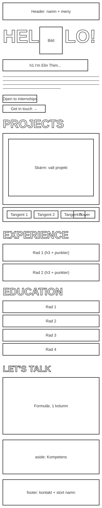
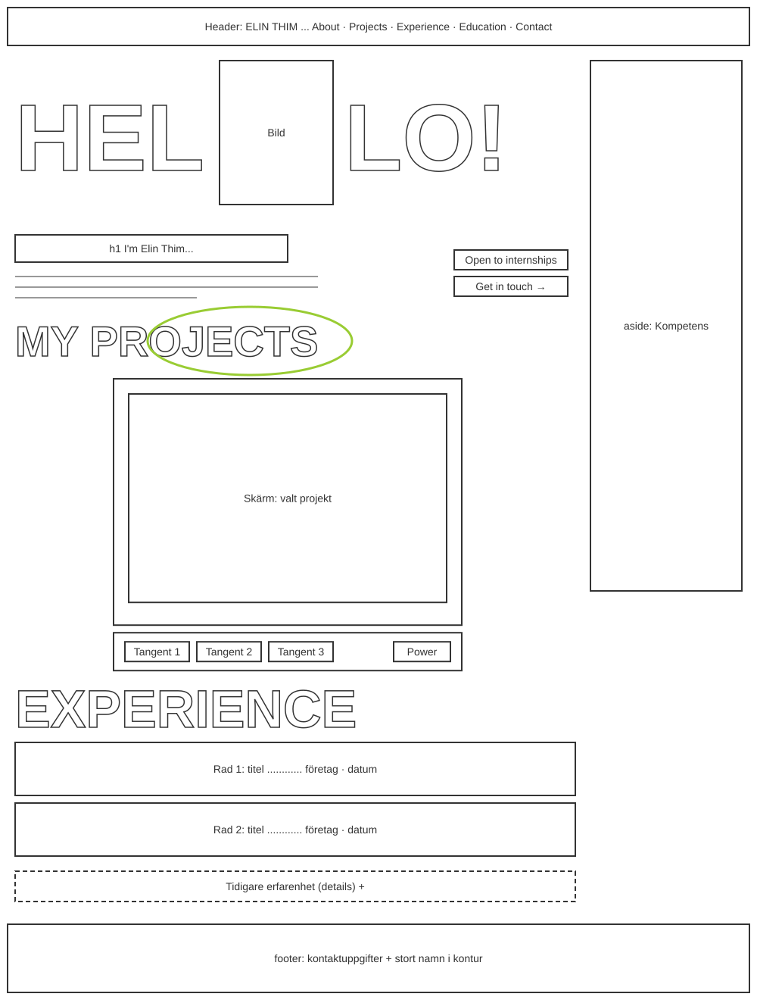

# Portfolio – Elin Thim

Min personliga portfolio, byggd som inlämningsuppgift 1 i kursen **BCU26D: HTML & CSS** på Medieinstitutet.
Sidan presenterar mig, mina projekt, min erfarenhet och utbildning, och har ett kontaktformulär.
Själva sidan är på **engelska** (`lang="en"`) så att den kan användas vid jobbansökningar även till internationella företag.
Kommentarerna i koden och den här README-filen är på svenska.

🔗 **Live-sida:** https://elinthim.github.io/elinthim-portfolio/ <!-- Byt ut mot din riktiga länk -->

## Design

Minimalistisk stil med kodkänsla: nästan vit bakgrund, svart text, stora smala rubriker (Anton) och detaljer
i syntaxfärgerna från kodeditor-temat One Dark (lila, blå, grön, gul och korallröd). Rubrikerna har små
`<h2>`-taggar runt sig, ingresserna ser ut som `// kommentarer` och fotot ligger i ett editorfönster.
Inspirerad av [annfro.com](https://annfro.com/) och Max Milkins portfolio.

Det roliga inslaget är en **klickbar retrodator** som visar projekten. Man trycker på tangenterna för att
byta projekt på den gröna fosforskärmen, och kan stänga av och slå på datorn med POWER-knappen.

**Allt är byggt i HTML och CSS – utan JavaScript.**

## Innehåll

| Del | Beskrivning |
| --- | --- |
| About | Stort "HEL [foto] LO!", rubrik (h1) och kort presentation |
| Projects | Retrodator med fem projekt: Blockathon 2026, ClaimPass (med länk till prototyp, kod och film), e-handelsplattform, AI-bildigenkänning och en riskbedömning från cybersäkerhetskursen (PDF) |
| Experience | Stora rader för Unionen och Xlent, samt en hopfällbar sektion med tidigare yrken |
| Education | Medieinstitutet, STI, Edugrade och Mittuniversitetet |
| Contact | Formulär med namn, e-post, webbplats, telefon, dropdown, checkbox och textarea |
| Sidofält | Skills (kompetenser) i `<aside>` |
| Sociala medier | Ikoner för GitHub, LinkedIn, Instagram och Facebook i hero och sidfot |
| CV | Länk för att ladda ner mitt CV som PDF (`files/elin-thim-cv.pdf`) |
| Sidfot | Kontaktuppgifter i `<address>` och mitt namn i stor kontur |

## Tekniker

- **HTML5** – semantiska element (`header`, `nav`, `main`, `section`, `article`, `aside`, `footer`, `address`, `time`, `details`, `fieldset`)
- **CSS3** – vanlig CSS utan ramverk: custom properties (variabler), Flexbox, Grid, `clamp()`, `@font-face`
- **Git & GitHub** – versionshantering, publicering via GitHub Pages och GitHub Actions

### Så fungerar retrodatorn

Tangenterna är **radioknappar** (bara en kan vara vald åt gången) och POWER är en **checkbox**.
Själva knapparna är dolda och deras `<label>` är stylade som tangenter. CSS-väljaren `:has()` kollar vilken
knapp som är vald och visar rätt projekt:

```css
.computer:has(#project-2:checked) .program--2 {
  display: block;
}
```

Eftersom det är riktiga formulärkontroller fungerar datorn också med tangentbord: Tab till tangenterna och
piltangenterna för att byta projekt. Webbläsare utan stöd för `:has()` visar alla tre projekten under varandra.

### Fler CSS-tekniker

| Effekt | Teknik |
| --- | --- |
| Rubriker som skalar efter innehållets bredd | Container queries, enheten `cqi` |
| Skärmen slås på som en gammal tjock-tv | `@keyframes` med `transform: scale()` |
| Kommandot skrivs ut en bokstav i taget | `animation` med `steps()` och `clip-path` |
| Linjer på skärmen | `repeating-linear-gradient()` |
| Handritad ring som ritas upp vid scroll | SVG + `stroke-dashoffset` + `animation-timeline: view()` |
| Rader som fylls med syntaxfärg vid hover | `background-size` med en enfärgad `linear-gradient()`, färgen via variabeln `--row-color` och `:nth-child()` |
| Kodtaggar `<h2>` runt rubrikerna och `<ElinThim />` som logga | `::before`/`::after` med `content`, och tom alt-text (`content: "<h2>" / ""`) så att skärmläsare hoppar över dem |
| Editorfönster med tre färgade prickar runt fotot | Pseudo-element med tre `radial-gradient()` |
| Ikoner som fylls med tjänstens färg, lutar sig och visar en etikett vid hover | `::before` som skalas upp, `transform: rotate()` och `::after` med `attr(data-label)` |
| Länkar på datorskärmen som blir inverterade vid hover | `[ View code → ]` med `::before`/`::after` |
| Namnet i sidfoten fylls med färg vid hover | `background-clip: text` |
| Understrykning som växer fram i menyn | `background-size` |
| HEL och LO! glider upp vid sidladdning | `clip-path` i `@keyframes` |

## Filstruktur

```text
.
├── index.html
├── css/
│   └── style.css
├── fonts/                     ← Anton, Inter, JetBrains Mono och VT323 + licenser (OFL)
├── files/
│   ├── elin-thim-cv.pdf       ← mitt CV på engelska
│   └── risk-assessment-bolagsverket.pdf  ← rapport från cybersäkerhetskursen
├── images/
│   ├── elin-thim.jpg
│   ├── elin-thim.webp
│   └── favicon.svg
├── docs/
│   ├── wireframe-mobil.svg
│   ├── wireframe-desktop.svg
│   └── screenshots/           ← skärmdumpar från tillgänglighetsgranskningen
└── .github/workflows/deploy.yml
```

Typsnitten ligger i projektet i stället för att laddas från Google Fonts. Det går snabbare och inga besökardata
skickas till Google, vilket är bättre för GDPR.

## Wireframes

Skisser för mobil och desktop.

| Mobil | Desktop |
| --- | --- |
|  |  |

## Responsiv design

Sidan är byggd **mobile first**. Grundstilarna gäller mobil och två brytpunkter bygger på layouten:

| Brytpunkt | Layout |
| --- | --- |
| < 40em (mobil) | En kolumn, sidofältet efter huvudinnehållet |
| ≥ 40em (tablet) | Klistrad meny, formuläret i två kolumner |
| ≥ 64em (desktop) | Sidofältet till höger om huvudinnehållet |

Brytpunkterna är i `em` i stället för `px` så att layouten anpassar sig om användaren har förstorat textstorleken.

## Tillgänglighet

Åtgärder i koden:

- `lang="en"` så att skärmläsare läser med engelskt uttal
- "Skip to content"-länk, första stoppet med Tab
- Logisk rubrikordning h1 → h2 → h3 utan hopp
- Alla formulärfält har `<label>` kopplade via `for`/`id`, och `autocomplete`
- Ikonlänkarna har dold text (t.ex. "GitHub") så att skärmläsare vet vart de leder; själva SVG-ikonen har `aria-hidden`
- Alt-text, `width` och `height` på bilden (förhindrar att layouten hoppar)
- Färgkontrast på minst 4.5:1 för all text. De ljusa syntaxfärgerna används bara som bakgrund bakom svart text eller som dekoration; för text på ljus bakgrund används mörkare varianter
- Retrodatorns tangenter är riktiga radioknappar i en `<fieldset>` med `<legend>`, så de fungerar med tangentbord och skärmläsare
- Dekorativa element (de stora bokstäverna, ringen, namnet i sidfoten) har `aria-hidden="true"`
- Tydlig fokusmarkering med `:focus-visible`
- `prefers-reduced-motion` stänger av alla animationer för den som valt det

### Granskningsresultat

<!-- Lägg skärmdumparna i docs/screenshots/ med dessa filnamn -->

**Chrome Lighthouse**


**W3C HTML Validator**


**Firefox Accessibility Tools**


## Kör lokalt

1. Klona repot: `git clone https://github.com/elinthim/REPO-NAMN.git`
2. Öppna mappen i VS Code
3. Högerklicka på `index.html` och välj **Open with Live Server**

## Kontakt

- E-post: [elin.thim@hotmail.com](mailto:elin.thim@hotmail.com)
- GitHub: [github.com/elinthim](https://github.com/elinthim)
- LinkedIn: [linkedin.com/in/elin-thim-0410b864](https://www.linkedin.com/in/elin-thim-0410b864)
- Instagram: [@elinthim](https://www.instagram.com/elinthim/)
- Facebook: [elin.thim](https://www.facebook.com/elin.thim/)

Ikoner för sociala medier från [Simple Icons](https://simpleicons.org/) (CC0).
